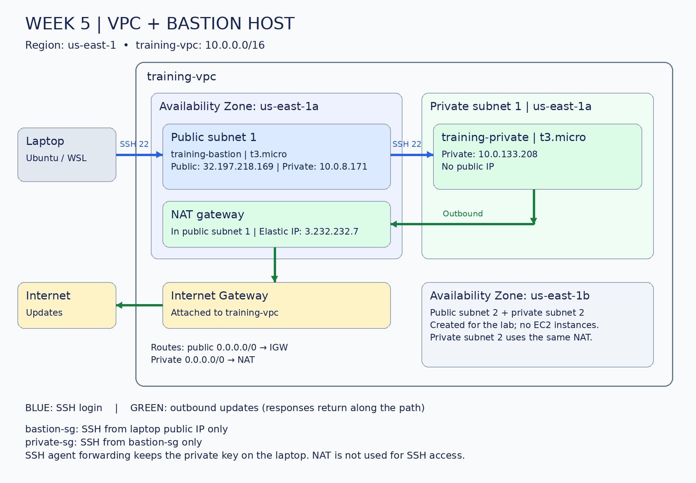

# Week 5 — Networking: VPC Deep Dive

## Goal
The purpose was to learn how to access a server while keeping it private.
- VPC: your own network in AWS.
- Bastion: the entry server you log into first.
- Private server: reachable through the bastion, without a public IP.
- NAT gateway: lets that private server download things from the internet.
For data engineering: you could keep a database or data-processing server private while still being able to manage it and download updates.

I built a VPC with two public and two private subnets, then launched a bastion and a private EC2 server.

**Login:** Laptop → Internet Gateway → bastion → private server.
SSH was allowed only from my laptop to the bastion, then from the bastion to the private server.

**Updates:** Private server → NAT gateway → Internet Gateway → internet.

I confirmed access with `hostname` and tested downloads with `sudo yum update -y`.

**Lesson:** The bastion lets me in; the NAT gateway lets the private server reach out.
## Cleanup checklist
- [ ] Confirm both lab instances are terminated, including the earlier incorrectly placed instance.
- [ ] Confirm the NAT gateway is deleted.
- [ ] Confirm its Elastic IP is released.
- [ ] Confirm `training-vpc` is deleted.
- [ ] Review Billing and save `billing-screenshot.png`.

The unrelated VPC was left unchanged. Check these boxes after verifying cleanup; billing records can lag behind resource deletion.

## What I learned
A subnet is public or private because of its routes, not its name or whether an instance has a public IP. A bastion provides controlled SSH access to private servers. A NAT gateway provides outbound internet access for private servers.
